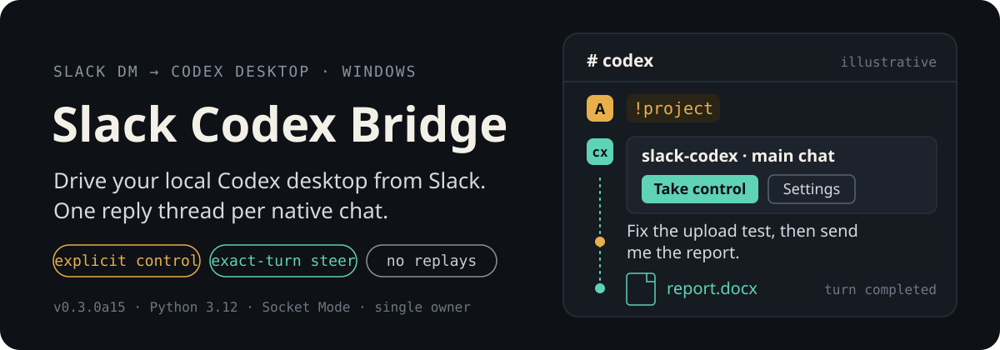
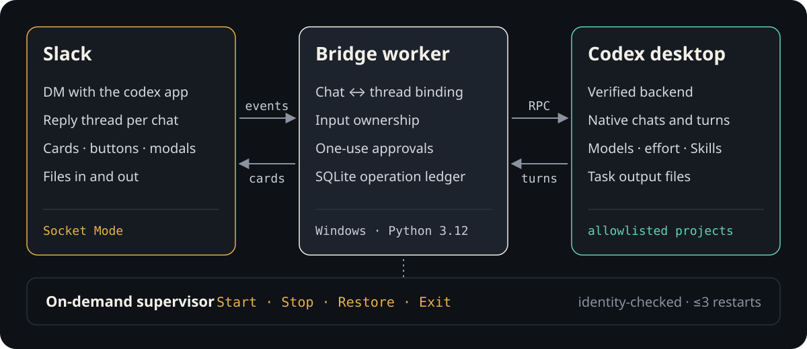

<p align="center">
  
</p>

<p align="center">
  <b>English</b> · <a href="./README.zh-CN.md">简体中文</a> · <a href="./docs/user-guide.zh-CN.md">User guide (中文)</a>
</p>

Slack Codex Bridge is a personal Windows bridge that lets you keep working with the
Codex desktop app on your own machine from Slack, including from your phone. Every
native Codex chat gets exactly one Slack reply thread. Tasks, steering, approvals,
attachments and returned files all stay inside that thread.

> [!NOTE]
> **Status: personal alpha (0.3.0a15).** It controls one verified Codex desktop/backend
> pair for a single Slack owner on Windows. It is not a multi-user or hosted service.

## A session in Slack

1. Send `!project` to the `codex` app DM and pick an allowlisted project.
2. Open a chat. The bridge posts one card and reuses its thread on every later open.
3. Press **Take control** while the chat is idle, then type the task in the thread.
4. While it runs, use **Steer** to add requirements or **Stop** to interrupt that exact turn.
5. Drop images or documents into the thread as input, and ask for results in plain
   language: *"send me the Word file from the last task"*.

## Why it is safe to leave running

| Mechanism | What it prevents |
| --- | --- |
| One durable chat ↔ thread binding | Messages reaching the wrong chat. Top-level text never goes to the "last used" chat. |
| Explicit input ownership | Slack and the desktop typing over each other. Ownership is dropped on reconnect, restart or wake. |
| Exact-turn Steer / Stop | Steering or stopping a newer task than the one you saw. |
| SQLite ledger before acknowledgement | Duplicate work. Uncertain operations are marked `unknown` and never replayed. |
| One-use, expiring approvals | Stale or replayed approval clicks. |
| Credentials only from environment variables | Tokens in config files, logs or arguments. |
| On-demand supervisor | Hidden background services. No login item, startup entry or scheduled task. |

## How it works

<p align="center">
  
</p>

The worker connects to Slack through Socket Mode, so no public endpoint is needed. It
verifies the Codex backend and desktop by process identity and TCP peer, not by
process name, and refuses to attach to an unrelated desktop. If the worker exits
unexpectedly, the supervisor restarts it at most three times (2/4/8 s back-off) and
only when identity can be verified. See [architecture](docs/architecture.md).

## Capabilities

- **Navigation**: project and chat discovery, one persistent thread per native chat, explicit Fork.
- **Control**: Take control, Steer, Stop, approvals and structured answers.
- **Settings**: native model and reasoning-effort selectors, paged Skills with exact-path details, Compact.
- **Files in**: up to 5 images or documents per input (10 MiB each, 20 MiB total), staged for 10 minutes when sent alone.
- **Files out**: natural-language retrieval of files produced in the same chat, with a chooser when several match.
- **Output**: concise Slack Markdown answers; status, operation details and account limits only on request.

<details>
<summary><b>Slack commands</b></summary>

| Command | Purpose |
| --- | --- |
| `!project` / `!projects` | Choose a project and open a chat |
| `!skills [keyword]` · `!skill PATH -- task` | Browse Skills or run one with a task |
| `!model` · `!effort` | Set model and reasoning effort for the next submission |
| `!compact` · `!fork` | Compact or fork the current chat |
| `!artifacts` · `!artifact "PATH"` | List or send task output files |
| `!status` | Connection state and account limits |
| `!op OP_ID` | Inspect one task or file-transfer operation |
| `!roots` · `!root-replace BINDING_ID` | Check bound threads and confirm a rebuild |

Most actions are also available as buttons on the chat card and in **Settings**.
</details>

## Getting started

**Requirements:** Windows x64, CPython 3.12, the Codex desktop app, and a Slack
workspace where you can install an app.

1. **Create the Slack app** from [`docs/slack-app-manifest.json`](docs/slack-app-manifest.json)
   (Socket Mode; bot scopes `chat:write`, `files:read`, `files:write`, `im:history`).
2. **Install the package** with hash-locked dependencies (the dev lock also pins the
   build backend used by `--no-build-isolation`):

   ```powershell
   python -m venv .venv
   .venv/Scripts/python.exe -m pip install --require-hashes -r requirements-dev.lock
   .venv/Scripts/python.exe -m pip install --no-build-isolation --no-deps .
   ```

3. **Configure**: copy [`bridge.example.json`](bridge.example.json) to `bridge.local.json`
   and fill in Slack IDs, Codex executable paths and versions, and the project allowlist.
   The file holds no secrets. Provide tokens via the `SLACK_APP_TOKEN` and
   `SLACK_BOT_TOKEN` environment variables.
4. **Check, start and run**:

   ```powershell
   bridge doctor          # versions, credentials present, session identity
   bridge desktop start   # verified controlled start of Codex desktop/backend
   bridge run             # connect Slack; Ctrl+C disconnects, Codex tasks keep running
   ```

For daily use, the windowless `bridge-supervisor` with Start / Stop / Restore / Exit
is described in [operations](docs/operations.md).

## Development

```powershell
python -m venv .venv
.venv/Scripts/python.exe -m pip install --require-hashes -r requirements-dev.lock
.venv/Scripts/python.exe -m pip install --no-build-isolation --no-deps -e .
./scripts/check_open_issues.ps1
```

The check runs pytest, Ruff, compilation, wheel/sdist validation, offline installation
and installed-import checks. It never reads credentials, deploys or sends Slack
messages. GitHub Windows CI runs the hosted scope; the positive `desktop_host`
lifecycle gate must pass on a supported local Windows host before release. The latest
full local run passed 679 tests; see [verification](docs/verification.md) for what
was and was not accepted live.

`src/` is the application, `tests/` the regression suite, and `scripts/` the reusable
checks and launchers. Historical phase plans and prototypes live in Git history.

## Documentation

| Document | Purpose |
| --- | --- |
| [User guide (中文)](docs/user-guide.zh-CN.md) | Daily Slack use and troubleshooting |
| [Operations](docs/operations.md) | Supervisor, installation and recovery |
| [Architecture](docs/architecture.md) | Routing, persistence and safety invariants |
| [Verification](docs/verification.md) | Current checks and live acceptance boundaries |
| [Content transport](docs/content-transport-policy.md) | Literal relay and local credential boundaries |
| [Repository workflow](docs/repository-workflow.md) | Checks, commits, PRs and deployment |

## Limits

- Windows only, one Slack owner, one verified Codex desktop/backend pair at a time.
- Model and effort changes apply to the next submission, not a running task.
- An `unknown` result means the outcome is uncertain: check `!status`, `!op` and the
  desktop before resending. Uploads and notifications are not retried automatically.
- Native MCP elicitation is outside the accepted scope.

## License

[MIT](LICENSE) © 2026 Alfred Zhang
