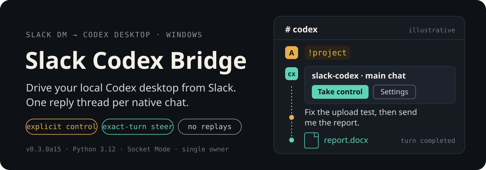
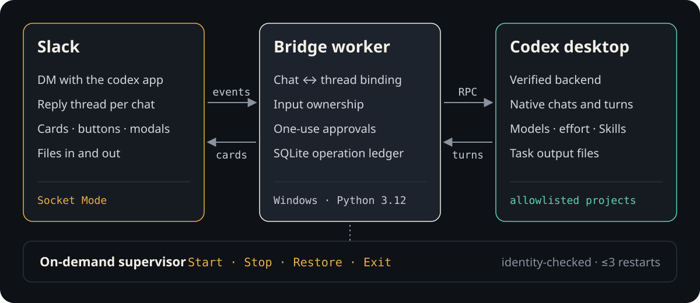

<p align="center">
  
</p>

<p align="center">
  <a href="./README.md">English</a> · <b>简体中文</b> · <a href="./docs/user-guide.zh-CN.md">使用说明</a>
</p>

Slack Codex Bridge 是一个运行在个人 Windows 电脑上的桥接程序，让你在 Slack（包括手机）里
继续使用本机的 Codex 桌面端。每个原生 Codex 会话固定对应一个 Slack 消息列，任务、追加要求、
审批、附件和取回的文件都留在这个消息列里。

> [!NOTE]
> **状态：个人 alpha 版（0.3.0a19）。** 只为单个 Slack 所有者控制一对已验证的 Codex
> 桌面端/后端，仅支持 Windows，不是多用户或托管服务。

## 在 Slack 里的一次会话

1. 在 `codex` 应用私信发送 `!project`，选择白名单内的项目。
2. 打开会话。桥接只发一张会话卡片，之后重复打开都复用同一个消息列。
3. 会话空闲时点 **Take control**，然后在消息列里发送任务。
4. 任务执行中用 **Steer** 追加要求，用 **Stop** 中断当前这一轮。
5. 把图片或文档发进消息列作为输入；用自然语言取回结果，例如“请把上次任务的 Word 文件发给我”。

## 为什么可以放心常驻

| 机制 | 防止什么 |
| --- | --- |
| 会话 ↔ 消息列的持久绑定 | 消息发错会话。未绑定的顶层消息不会送到“最后打开”的会话。 |
| 显式输入控制权 | Slack 和桌面端同时输入。重连、重启或唤醒后控制权自动失效。 |
| 精确到轮次的 Steer / Stop | 误操作到比你看到的更新的任务。 |
| 先写 SQLite 账本再确认事件 | 重复执行。结果不确定的操作标记为 `unknown`，绝不自动重放。 |
| 一次性、会过期的审批 | 过期或重放的审批点击。 |
| 凭据只从环境变量读取 | 令牌出现在配置文件、日志或命令参数里。 |
| 按需启动的管理器 | 隐藏的后台服务。没有开机启动、登录注册或计划任务。 |

## 工作原理

<p align="center">
  
</p>

已有桌面可在管理器中选择、确认后接入，无需重启。固定版本的 Windows 桌面还可通过已有
IPC 通道连接，支持已打开会话的任务、附件、精确 Stop 和文件取回；Steer、审批、模型与 Skills
设置、Compact、Fork 在 Codex 桌面操作。详见[连接模式与版本限制](docs/adaptive-instance-selection.md)。

桥接进程通过 Socket Mode 连接 Slack，不需要公网入口。共享 WebSocket 模式按进程身份和实际 TCP 对端验证
Codex 后端与桌面端，而不是只看进程名，遇到无关的桌面实例会拒绝接管。桥接进程意外退出时，
管理器只在身份可验证的前提下最多恢复 3 次（退避 2/4/8 秒）。详见 [架构说明](docs/architecture.md)。

## 功能

- **导航**：项目和会话发现，每个原生会话一个持久消息列，显式 Fork。
- **控制**：Take control、Steer、Stop、审批和结构化回答。
- **设置**：原生模型和推理强度选择、分页 Skills（可查看精确路径）、Compact。
- **文件输入**：每次最多 5 个图片或文档（单个 10 MiB，总计 20 MiB）；只发附件时暂存 10 分钟。
- **文件输出**：文档和图片小于 30MB 默认直接发送；视频、达到或超过阈值的文件先显示确认按钮，点击后直接发送。自然语言取回仍然可用。
- **桥接配置**：在 Windows 管理器中设置自动发送、大小限制及中文/英文，Windows 和 Slack 界面使用同一语言设置。详见[发送规则](docs/output-delivery-settings.md)。
- **输出**：简洁的 Slack Markdown 回答；连接状态、操作详情和账户额度通过显式命令查看。

<details>
<summary><b>Slack 命令</b></summary>

| 命令 | 用途 |
| --- | --- |
| `!project` / `!projects` | 选择项目并打开会话 |
| `!skills [关键词]` · `!skill 路径 -- 任务` | 浏览技能，或用指定技能执行任务 |
| `!model` · `!effort` | 设置下一次提交的模型和推理强度 |
| `!compact` · `!fork` | 压缩或分叉当前会话 |
| `!artifacts` · `!artifact "PATH"` | 列出或发送任务产物 |
| `!status` | 连接状态和账户额度 |
| `!op OP_ID` | 核对某个任务或文件传输记录 |
| `!roots` · `!root-replace BINDING_ID` | 检查已绑定的消息列，并确认重建 |

大部分操作也可以通过会话卡片和 **Settings** 中的按钮完成。
</details>

## 快速开始

**环境要求：** Windows x64、CPython 3.12、Codex 桌面端，以及一个可以安装应用的 Slack 工作区。

1. **创建 Slack App**：使用 [`docs/slack-app-manifest.json`](docs/slack-app-manifest.json)
   （Socket Mode；Bot 权限 `chat:write`、`files:read`、`files:write`、`im:history`）。
2. **安装**（开发锁文件同时固定了 `--no-build-isolation` 所需的构建后端）：

   ```powershell
   python -m venv .venv
   .venv/Scripts/python.exe -m pip install --require-hashes -r requirements-dev.lock
   .venv/Scripts/python.exe -m pip install --no-build-isolation --no-deps .
   ```

3. **配置**：把 [`bridge.example.json`](bridge.example.json) 复制为 `bridge.local.json`，
   填写 Slack ID、Codex 可执行文件路径与版本、项目白名单。该文件不含任何密钥；
   令牌通过环境变量 `SLACK_APP_TOKEN` 和 `SLACK_BOT_TOKEN` 提供。
4. **检查、启动并运行**：

   ```powershell
   bridge doctor          # 检查版本、凭据是否就绪、会话身份
   bridge desktop start   # 受控启动并验证 Codex 桌面端/后端
   bridge run             # 连接 Slack；Ctrl+C 断开桥接，Codex 任务继续运行
   ```

日常使用推荐无控制台的 `bridge-supervisor`（Start / Stop / Restore / Exit），
见 [运行维护说明](docs/operations.md)。

## 开发

```powershell
python -m venv .venv
.venv/Scripts/python.exe -m pip install --require-hashes -r requirements-dev.lock
.venv/Scripts/python.exe -m pip install --no-build-isolation --no-deps -e .
./scripts/check_open_issues.ps1
```

检查脚本会执行 pytest、Ruff、编译、wheel/sdist 校验、离线安装和安装后导入检查，
不读取凭据、不部署、不发送 Slack 消息。GitHub Windows CI 运行托管范围的测试；
正向 `desktop_host` 生命周期检查需在受支持的本地 Windows 主机上通过后才能发布。
最近一次本地全量检查通过 679 个测试，实际验收边界见 [验证记录](docs/verification.md)。

`src/` 是应用本体，`tests/` 是回归测试，`scripts/` 是可复用的检查和启动脚本。
历史阶段计划和原型保留在 Git 历史中。

## 文档

| 文档 | 内容 |
| --- | --- |
| [使用说明](docs/user-guide.zh-CN.md) | 日常 Slack 使用与故障处理 |
| [Operations](docs/operations.md) | 管理器、安装与恢复 |
| [Architecture](docs/architecture.md) | 路由、持久化与安全不变量 |
| [Verification](docs/verification.md) | 当前检查与实际验收边界 |
| [Content transport](docs/content-transport-policy.md) | 原文转发与本地凭据边界 |
| [Repository workflow](docs/repository-workflow.md) | 检查、提交、PR 与部署 |

## 限制

- 仅支持 Windows，同一时间只服务一个 Slack 所有者和一对已验证的 Codex 桌面端/后端。
- 模型和推理强度设置只作用于下一次提交，不改变正在执行的任务。
- `unknown` 表示结果不确定：先查看 `!status`、`!op` 和桌面端，再决定是否重发。
  上传和通知不会自动重试。
- 原生 MCP elicitation 不在已验收范围内。

## 开源协议

[MIT](LICENSE) © 2026 Alfred Zhang
